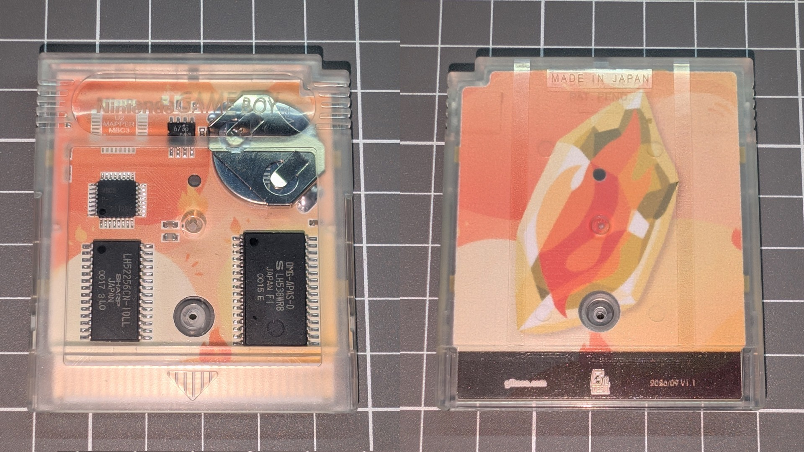
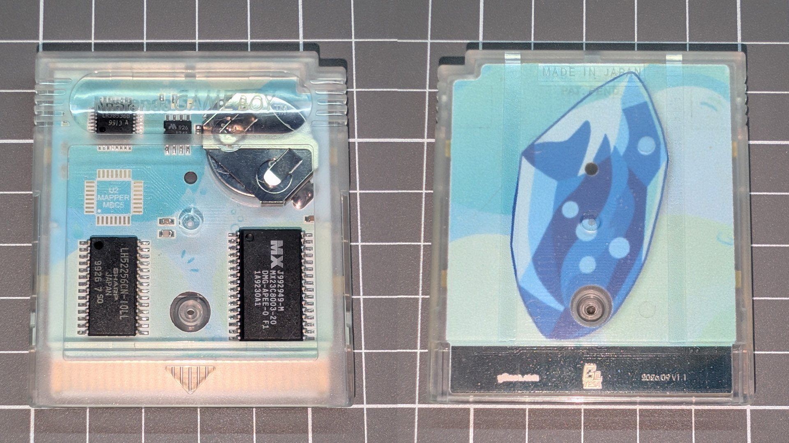
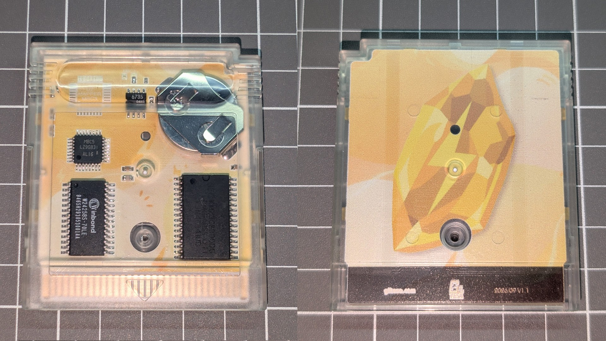

# Pokémon Red, Blue and Yellow for Game Boy: Custom Motherboard

This is a **full-color printed custom motherboard** for the games **Pokémon Red, Pokémon Blue and Pokémon Yellow** for Game Boy.

You can use it to customize your original cartridge, whose battery has long since died or whose original PCB has become damaged or corroded.

## Notes

*   This motherboard is designed for the **MBC3A**, **MBC3B** and **MBC5** cartridge revisions used in most international releases. It is not compatible with the early Japanese MBC1 revisions. Please check the installation guide for full compatibility information before purchasing.
*   Although it is designed for use with Pokémon, it is also compatible with any other game whose motherboard has the identification number **DMG-A02-01** or **DMG-KFDN-10** and does not use an RTC.

## Would you like it?

[**Pokémon Red, Blue and Yellow for Game Boy: Custom Motherboard**](https://shop.giltesa.com/?p=8113)

## License

This project is licensed under a **Creative Commons** license:
**[Attribution-NonCommercial-ShareAlike 4.0 International (CC BY-NC-SA 4.0) ](https://creativecommons.org/licenses/by-nc-sa/4.0/)**

Check the [LICENSE.md](LICENSE.md) for more information.
